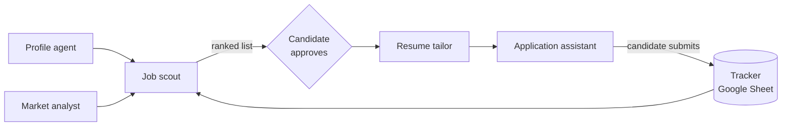

# Job Search Agents

A small multi-agent pipeline that finds job postings matching a candidate's profile, ranks them, tailors a CV for each one, prepares the application, and tracks progress in a Google Sheet.

It started as a learning project to understand how pipelines and agent flows fit together. Each agent is just a Markdown file of instructions that a Claude agent (for example in Claude Desktop) follows.

> **Version 1 principle: the agent prepares, the candidate submits.** Nothing is ever sent automatically.

## How it works



1. **Scout** reads the profile and the tracker, then writes a ranked list of recent postings (excluding anything already applied to).
2. The **candidate** picks which jobs to pursue.
3. **Resume tailor** creates one tailored CV per selected job.
4. **Application assistant** prepares the form answers and links. The candidate reviews and submits.
5. **Tracker** records the application and later updates its stage.

## Agents

| # | Agent | File | Runs | Output |
|---|-------|------|------|--------|
| 1 | Profile | [`agents/01_profile_agent.md`](agents/01_profile_agent.md) | Once, then on updates | `profile/profile.md` |
| 2 | Market analyst | [`agents/02_market_analyst.md`](agents/02_market_analyst.md) | Weekly | `jobs/market_insights.md` |
| 3 | Job scout | [`agents/03_job_scout.md`](agents/03_job_scout.md) | Daily | `jobs/jobs_YYYY-MM-DD.md` |
| 4 | Resume tailor | [`agents/04_resume_tailor.md`](agents/04_resume_tailor.md) | Per selected job | `applications/<Company>/<Company>_<Role>.pdf` |
| 5 | Application assistant | [`agents/05_application_assistant.md`](agents/05_application_assistant.md) | After approval | Application pack ready to submit |
| 6 | Tracker | [`agents/06_tracker.md`](agents/06_tracker.md) | On every event | One row per application |
| - | Orchestrator (optional) | [`agents/00_orchestrator.md`](agents/00_orchestrator.md) | Daily | Runs the sequence above |

## Repository layout

```
agents/       Instructions for each agent
profile/      Your CV and profile.md (kept local; see profile.example.md)
jobs/         Daily ranked lists and market insights (generated, kept local)
applications/ One folder per company with tailored CVs (kept local)
tracker/      tracker_schema.md and tracker_template.csv
```

Personal folders are listed in `.gitignore`, so your data stays on your computer even if you fork this repo.

## Getting started

1. **Clone or fork** this repo and open the folder in your agent environment (for example Claude Desktop with the folder connected).
2. **Create your profile.** Copy [`profile/profile.example.md`](profile/profile.example.md) to `profile/profile.md`, or ask the Profile agent to interview you and fill it in. Put your CV in `profile/`.
3. **Create the tracker.** Make a Google Sheet that follows [`tracker/tracker_schema.md`](tracker/tracker_schema.md) (the header row is in [`tracker/tracker_template.csv`](tracker/tracker_template.csv)) and paste its ID into your local copy of the schema.
4. **Connect your tools.** The agents use Google Sheets for the tracker and Gmail to read job-alert emails. Set up daily alerts on the job boards you use.
5. **Run in order:** Profile, Tracker, Job scout (manually first), then Resume tailor and Application assistant. Schedule the scout daily once you trust its output.

## Global rules every agent follows

- **Never invent.** Only reorder, emphasize and rephrase real experience.
- **Never bypass** logins, CAPTCHAs or anti-bot protections. If a site blocks the agent, give the candidate the link.
- **Never submit** an application in version 1.
- **The tracker is the single source of truth** for what has been applied to.
- **Do not scrape LinkedIn.** Use job boards, alert emails and search instead.
- **Ask when unsure** instead of guessing personal data.

## File naming

- CVs: `applications/<Company>/<Company>_<Role>.pdf`, for example `Acme_DataAnalyst.pdf`.
- Reuse an existing company folder. If the file exists, save `_v2`, `_v3`, and so on.
- No spaces or accents; normalized company names.
- Daily lists: `jobs/jobs_YYYY-MM-DD.md`.

## Known limitations

- Company career pages and some job boards (LinkedIn, Indeed) are not reachable by the agent in every environment, so coverage depends on job boards and email alerts.
- Dates on cached job pages are approximate, so verify them before applying.
- Roles requiring a language you don't speak are kept as `Stretch` rather than discarded.

## Roadmap

Market analyst and daily email digest, then the orchestrator. Automatic submission is deliberately out of scope for now.

## License

[MIT](LICENSE)
